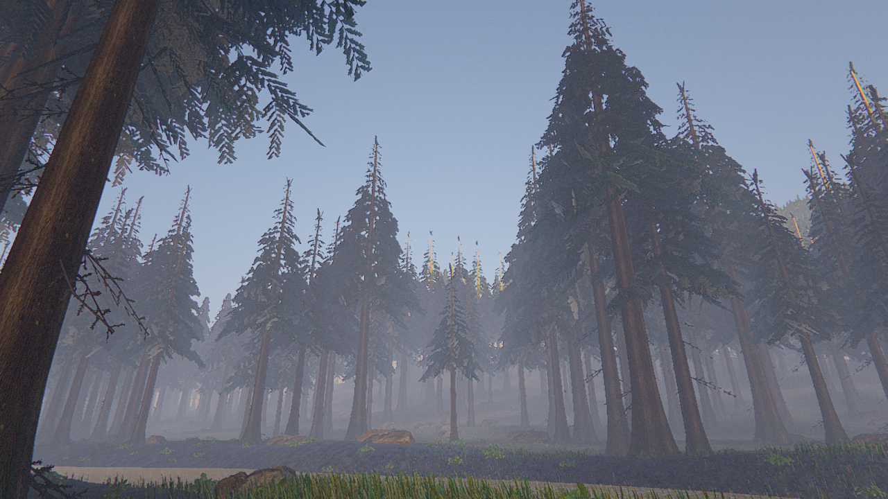

# Tefra engine

Tefra (motor 3D) es un motor open source, clean-room, orientado a **mundos abiertos fotorrealistas** con rendimiento escalable por niveles de calidad. Usa C++20 y Vulkan 1.2 y funciona en Windows (MinGW) y Linux.

> Estado: **M2 en curso**. Vertical slice "Valle de Ceniza": bosque de coníferas brumoso de 2×2 km (`tefra_bench --scene valley`). Ver `docs/specs/`, `docs/research/` y `CLAUDE.md`.



Render diferido PBR con render graph y bindless. Atmósfera física (Hillaire) y niebla volumétrica con sombras. Sombras PCSS en cascadas y sombras de contacto. GTAO, oclusión del cielo bajo el dosel y TAA/TAAU. Terreno procedural con POM y tiling estocástico. Vegetación GPU-driven con agujas horneadas y hierba generada en el vertex shader. Bloom, auto-exposición, AgX y gradación. Todos los assets son CC0 o procedurales.

## Compilar

Requisitos: CMake ≥ 3.25, Ninja y GCC ≥ 13 o Clang ≥ 17. Para compilar shaders hace falta glslang: en Windows viene con el Vulkan SDK y en Linux es el paquete `glslang-tools`.

```sh
# Linux
cmake --preset linux-release && cmake --build --preset linux-release
ctest --preset linux-release

# Windows (MinGW-w64 + Ninja en el PATH, Vulkan SDK instalado)
cmake --preset windows-mingw-release
cmake --build --preset windows-mingw-release
```

Cada push compila un build de Windows: está en *Actions → CI → artifact `tefra-windows`*.

## Ejecutables

| Ejecutable | Qué hace |
|---|---|
| `tefra_info` | Lista las GPU e indica si cumplen el baseline (Vulkan 1.2 + bindless + sync2) |
| `tefra_viewer` | Ventana interactiva. Botón derecho = mirar, WASD/QE = moverse, Shift = rápido, F12 = captura, Esc = salir |
| `tefra_bench` | N frames y un informe JSON `tefra-bench/1`: frame time p50/p95/p99, ms de GPU por pase, memoria y validación |

Opciones comunes: `--gpu N`, `--width/--height`, `--frames`, `--warmup`, `--capture file.png`, `--validation` y `--strict`. Ver `--help`.

## Licencia

Apache-2.0. Las dependencias están en `THIRD_PARTY.md`.
